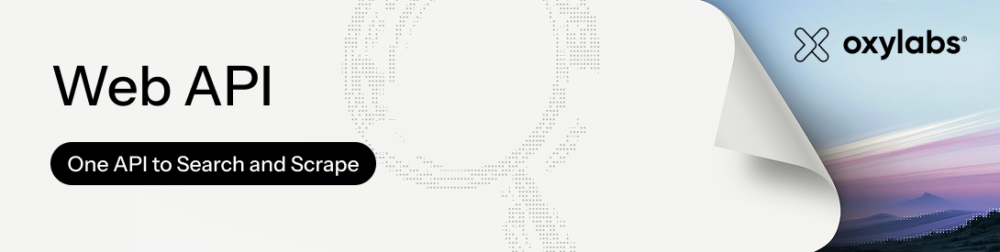

# Google News scraper

[]([https://oxylabs.io/products/web-api/scrape?utm_source=github&utm_medium=referral&utm_content=web_api_waitinglist&groupid=877](https://oxylabs.io/products/web-api/scrape?utm_source=877&utm_medium=affiliate&groupid=877&utm_content=google-news-scraper-github&transaction_id=102c8d36f7f0d0e5797b8f26152160))

<a href="https://oxylabs.io"></a>
<a href="https://developers.oxylabs.io"></a>
<a href="https://dashboard.oxylabs.io"></a>
<a href="https://discord.gg/YOUR-INVITE"></a>
<a href="https://www.youtube.com/@oxylabs"></a>

- [Free Google News Scraper](#free-google-news-scraper)
    + [Prerequisites](#prerequisites)
    + [Installation](#installation)
    + [Getting the topic to scrape](#getting-the-topic-to-scrape)
    + [Scraping](#scraping)
    + [Notes](#notes)
- [Oxylabs Web API](#oxylabs-web-api)
    + [Request sample](#request-sample)
- [Practical use cases](#practical-use-cases)
- [Why choose Oxylabs?](#why-choose-oxylabs)
- [FAQ](#faq)
- [Learn more](#learn-more)
- [Featured in Technical Communities](#featured-in-technical-communities)
- [Contacts](#contacts)


## Free Google News Scraper

### Prerequisites

To run this tool, you need to have Python 3.11 installed in your system.

### Installation

Open up a terminal window, navigate to this repository and run this command:

`make install`

### Getting the topic to scrape

This tool is used to scrape Google News articles based on the topic they're listed in. 

First of all, open up Google News, and look through the topics listed in the top header of the webpage. 


Click on a topic you wish to scrape. In this example we'll be accessing news data in the the `Business` topic. 

Next, look at the URL in your browser and copy the string of characters that come after `/topics/`, that's your topic ID.


In the URL shown in the screenshot, the topic ID would be `CAAqJggKIiBDQkFTRWdvSUwyMHZNRGx6TVdZU0FtVnVHZ0pWVXlnQVAB`. 

Save this value, you'll need it for scraping the articles.

### Scraping 

To scrape Google News data from your selected topic, run this command in your terminal:
`make scrape TOPIC_ID=<your_selected_topic_id>`

With the `Business` topic ID selected before, the command should look like this:

`make scrape TOPIC_ID=CAAqJggKIiBDQkFTRWdvSUwyMHZNRGx6TVdZU0FtVnVHZ0pWVXlnQVAB`

After running the command, you should see this in your terminal:


When the tool has finished running, you should see a file named `articles.csv` in the directory you were running the tool.

If you open the generated CSV file, the data should look something like this:


### Notes

In case the code doesn't work or your project is of bigger scale, please refer to the second part of the tutorial. There, we showcase how to scrape public data with Oxylabs Web API.

## Oxylabs Web API

[Web API](https://developers.oxylabs.io/products/web-api) is Oxylabs REST API for searching the web and scraping pages in real time. The `/scrape` endpoint includes a dedicated source to scrape Google News data & pull **sources, titles, URLs, and dates from published articles** straight from the News tab of Google Search results, up to 2K free results on a trial. It handles JavaScript rendering, rotating proxies, and geo-targeting for you, returning clean, parsed data so you can focus on processing it instead of maintaining a scraper.

After you claim your trial, using Web API consists of three main steps:
1. Create a Web API instance and generate an API key via our [dashboard](https://dashboard.oxylabs.io)
2. Send a request
3. Retrieve the data in JSON, HTML, or Markdown

### Request sample
In the examples below, we make a request to the dedicated Google Search scraper to obtain News results for the search term `adidas`. Setting `udm` to `12` switches Google's UI mode to the News tab, the same way it would if you clicked "News" on google.com.

```
import os
import requests
from pprint import pprint

# Structure payload.
payload = {
    'query': 'adidas',
    'udm': '12',
    'output': ['json'],
}

# Get response.
response = requests.post(
    'https://webapi.oxylabs.io/v1/scrape/google/search',
    headers={'Authorization': f"Bearer {os.environ['OXYLABS_WEB_API_KEY']}"},
    json=payload,
)

# Print prettified response to stdout.
pprint(response.json())
```

To see **request samples in other languages** and **parameter values** along with their **descriptions**, please take a look at our extensive [Google News API documentation](https://developers.oxylabs.io/products/web-api/scrape/dedicated-scrapers).

## Practical use cases

Whether you're running the free topic-based scraper in this repo or use the Oxylabs Google News scraper, the news data can be used for common workflows like:

1. **Brand monitoring** – track every mention of your company or product in the news and catch new media coverage as soon as it's published.
2. **AI training data** – collect structured news articles at scale, useful for building datasets to fine-tune or evaluate language models on current events.
3. **SEO and content research** – compare headlines, publishers, and publication dates across a topic to spot top stories and content gaps.
4. **Product launch tracking** – follow news articles about product launches in your industry or your competitors' launches, as they appear on Google News.

## Why choose Oxylabs?

- **Handles large volumes:** Automatic proxy rotation and IP management mean you're not maintaining web scraping infrastructure yourself to collect Google News data at scale.
- **Structured data on demand:** Get results as clean JSON, HTML, or Markdown, instead of parsing raw Google News articles yourself.
- **Reliable success rates:** Built to keep working even as Google's markup and anti-bot defenses change.
- **Dedicated support:** Get help from integration to debugging, through live chat or [Discord](https://discord.gg/Pds3gBmKMH).

## FAQ

### Is this Google News scraper free?

Yes. The Python tool in this repository is a free tool — it scrapes public Google News topic pages directly and requires no API key. [Oxylabs Web API](#oxylabs-web-api) is a separate, paid option for larger-scale or more resilient scraping needs.

### Is there a dedicated Google News API endpoint?

Not as a separate endpoint. Web API's Google Search scraper (`/v1/scrape/google/search`) covers Google News through the `udm` parameter: setting `udm` to `12` switches results to the News tab, the same filter Google's own UI uses.

### Can I search Google News by keyword instead of a topic ID?

The free scraper in this repo only supports topic-based web scraping (see [Getting the topic to scrape](#getting-the-topic-to-scrape)). Web API's Google News data scraper accepts a query`query`  parameter instead, so you can run a Google News search for any keyword and still get back the same kind of search results.

## Learn more

For a full walkthrough of both approaches in this repo — the free scraper and Web API — see the companion guide: [How to Scrape Google News: Step-by-Step Guide](https://oxylabs.io/blog/how-to-scrape-google-news). Full parameters and request samples for Web API are in the [dedicated scrapers documentation](https://developers.oxylabs.io/products/web-api/scrape/dedicated-scrapers).

## Featured in Technical Communities

This project's companion tutorial has been shared across developer communities:
- [How to Scrape Google News: Step-by-Step Guide](https://oxylabs.io/blog/how-to-scrape-google-news) — Oxylabs Blog
- [How to Scrape Google News with Python: Step-by-Step Guide](https://dev.to/oxylabs-io/how-to-scrape-google-news-with-python-step-by-step-guide-2gkf) — DEV Community

Read More Google Scraping Related Repositories: [Google Sheets for Basic Web Scraping](https://github.com/oxylabs/web-scraping-google-sheets), [Google Play Scraper](https://github.com/oxylabs/google-play-scraper), [How To Scrape Google Jobs](https://github.com/oxylabs/how-to-scrape-google-jobs), [How to Scrape Google Scholar](https://github.com/oxylabs/how-to-scrape-google-scholar), [How to Scrape Google Flights with Python](https://github.com/oxylabs/how-to-scrape-google-flights), [How To Scrape Google Images](https://github.com/oxylabs/how-to-scrape-google-images), [Scrape Google Search Results](https://github.com/oxylabs/scrape-google-python), [Scrape Google Trends](https://github.com/oxylabs/how-to-scrape-google-trends)

## Contacts

If you have questions or need support, reach out at [support@oxylabs.io](mailto:support@oxylabs.io), through live chat on the [Oxylabs Dashboard](https://dashboard.oxylabs.io), or join our [Discord community](https://discord.gg/Pds3gBmKMH). For enterprise inquiries, contact your dedicated account manager.
